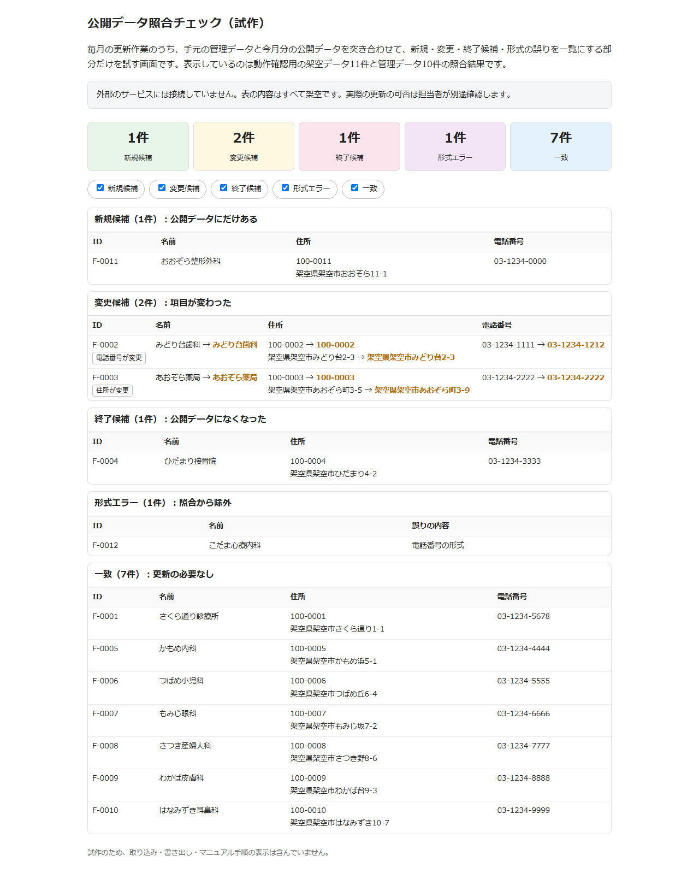
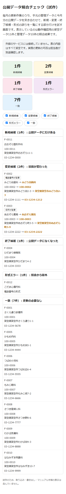

# 公開データ照合チェック（試作）

毎月の更新作業のうち、手元の管理データと今月分の公開データを突き合わせて、新規・変更・終了候補・形式の誤りを一覧にする部分だけを試すものです。

## このPOCで確かめたこと

- 架空の管理データ10件と架空の公開データ11件をIDで突き合わせ、新規候補1件・変更候補2件・終了候補1件・一致7件・形式エラー1件に分類できることをテストで確認した
- 変更候補については、変わった項目が電話番号（1件）と住所（1件）であることをテストで確認した
- 電話番号の形式が誤っている公開レコードを検出して照合から除外できることをテストで確認した
- 公開データ側でIDが重複したレコードを誤りとして検出できることをテストで確認した
- 前後の空白の違いだけでは変更とみなさないことをテストで確認した
- 外部サービスへの接続はなく、表示データはすべて架空である

## 作っていない範囲

- 実際の公開データの取り込みや表計算ファイルの読み書き
- 管理データへの書き戻しやデータベースの更新
- 作業手順書の表示や担当者の承認フロー

## 次の進め方

- 実際の公開データの形式に合わせて取り込み部分を追加する
- 更新内容の承認と書き戻しの手順を決める
- 誤りや重複があった場合の担当者への通知方法を決める

## 動かし方

- `docs/index.html` をブラウザで開くだけで照合結果が表示される
- テストは `npm test` で実行する
- 外部サービスは使わない
